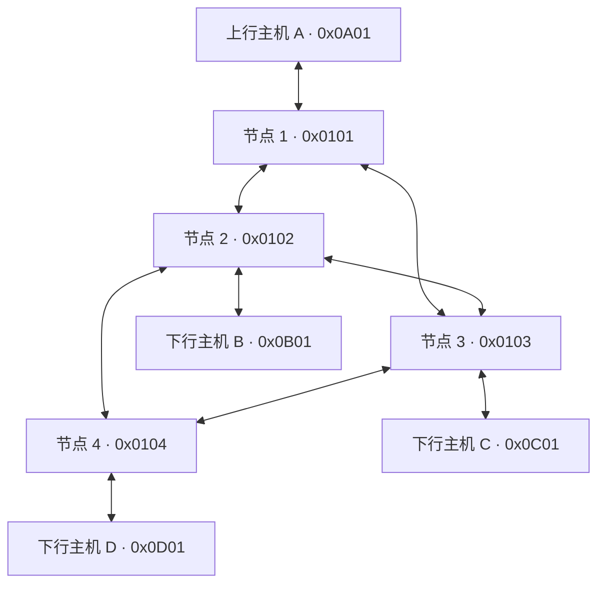

# 交换网络实验

本项目用 C 实现四节点交换网络，支持外部主机接入、域内逐跳转发、按逻辑地址分流、源网络号检查和 CRC-16 校验。基础链路使用 UDP；Open vSwitch 提供可观测的二层承载，蓝牙适配器可把指定链路接入 BR/EDR L2CAP。

第一次运行建议先完成单机演示，再按需要选择 OVS、双机网络或蓝牙。以下命令在 **Ubuntu 的 Bash 终端、仓库根目录**执行；已验证环境为 Ubuntu 24.04 / x86_64。Windows 用户可在 Ubuntu 虚拟机中运行。

## 拓扑与地址



逻辑地址共 16 位，高 8 位是网络号，低 8 位是站点号。`0x0101` 是节点地址，`127.0.0.1:1103` 是传输端点，两者用途不同。

| 外部主机 | 对应逻辑信道 | 接入节点 / 逻辑端口 | 节点 UDP 端口 | 主机 UDP 端口 |
|---|---|---|---:|---:|
| A · `0x0A01` | 上行 | 节点 1 / 3 | 1103 | 9001 |
| B · `0x0B01` | 下行 3 | 节点 2 / 4 | 3104 | 9002 |
| C · `0x0C01` | 下行 5 | 节点 3 / 4 | 2104 | 9003 |
| D · `0x0D01` | 下行 1 | 节点 4 / 3 | 4103 | 9004 |

## 编译与快速检查

```bash
sudo apt-get update
sudo apt-get install -y build-essential python3 git tmux
git clone https://github.com/github-shen/cs-project-20261030.git
cd cs-project-20261030
make
```

已有仓库时直接进入目录执行 `make`。构建生成 `bin/switch` 和 `bin/host`；普通 UDP 模式无需蓝牙开发库，也无需 root。

先运行两组自动检查，确认程序可用：

```bash
python3 tests/udp_regression.py -v
python3 tests/test_switch_regressions.py --output "logs/core-$(date +%Y%m%d-%H%M%S)"
```

预期分别为 **2 项测试 OK** 和 **9 项检查 PASS**，退出码均为 0。第二组覆盖节点收发、坏 CRC、多终端学习和回程；结果写入指定目录的 `summary.json`。输出目录必须是新目录，测试结束会关闭自己的进程。

## 单机交互演示

`config/` 使用回环地址。下面启动四个节点和四个主机，所有会话放在专用的 `cnet` tmux 服务器中。重复运行前先完成本节末尾的停止步骤。

```bash
for n in 1 2 3 4; do
  tmux -L cnet new-session -d -s "n$n" -c "$PWD" "./bin/switch config/node$n.conf"
done
tmux -L cnet new-session -d -s h1 -c "$PWD" './bin/host 0x0A01 9001 127.0.0.1 1103'
tmux -L cnet new-session -d -s h2 -c "$PWD" './bin/host 0x0B01 9002 127.0.0.1 3104'
tmux -L cnet new-session -d -s h3 -c "$PWD" './bin/host 0x0C01 9003 127.0.0.1 2104'
tmux -L cnet new-session -d -s h4 -c "$PWD" './bin/host 0x0D01 9004 127.0.0.1 4103'
tmux -L cnet list-sessions
```

应有 `n1`～`n4`、`h1`～`h4` 共 8 个会话。发送 A → C 的消息，再查看 C 的接收记录：

```bash
tmux -L cnet send-keys -t h1 'send 0x0C01 hello' Enter
sleep 1
tmux -L cnet capture-pane -p -t h3 -S -20
```

预期包含 `[RECV] 来自0x0A01: "hello"`。再测试节点间交付、坏 CRC 和转发表：

```bash
tmux -L cnet send-keys -t n1 'send 0x0104 node-test' Enter
tmux -L cnet send-keys -t h1 'sendbad 0x0C01 bad-crc' Enter
tmux -L cnet send-keys -t n1 'table' Enter
tmux -L cnet send-keys -t n1 'stats' Enter
sleep 1
tmux -L cnet capture-pane -p -t n4 -S -20
tmux -L cnet capture-pane -p -t n1 -S -80
```

节点 4 应交付 `node-test`，节点 1 应报告 CRC 校验失败，C 不应收到 `bad-crc`。`table` 显示外部端口表、学习记录和内部转发表；`stats` 显示转发、丢弃、重路由等计数。

可用 `tmux -L cnet attach -t n1` 直接进入节点终端，按 **Ctrl+B，再按 D** 返回原终端。结束整组演示：

```bash
tmux -L cnet kill-server
```

| 交互命令 | 适用程序 | 用途 |
|---|---|---|
| `send <目的地址> <文本>` | switch / host | 发送正常帧 |
| `sendbad <目的地址> <文本>` | switch / host | 发送坏 CRC 帧，验证拒绝逻辑 |
| `table` | switch | 查看端口、学习记录及路由 |
| `stats` / `reset` | switch | 查看 / 清零统计 |
| `quit` | switch / host | 退出当前程序 |

## OVS 自动验收

此模式把四个节点放进独立网络命名空间，业务 UDP 必须经过 OVS 网桥。验收同时检查接收端消息和专属 UDP 流计数，避免仅凭“能通信”判断已经过 OVS。

```bash
sudo apt-get install -y openvswitch-switch iproute2
sudo systemctl start openvswitch-switch
make
python3 -m unittest discover -s tests -p 'test_ovs_acceptance.py' -v
sudo bash scripts/ovs_netns.sh verify --output "logs/ovs-$(date +%Y%m%d-%H%M%S)"
```

预期为 **14 项单元测试 OK、32 项验收记录 PASS**。验收覆盖四主机 12 个方向、四节点 12 个方向、坏 CRC、非法源、无路由、分流稳定性及 CLI。查看结果目录中的 `result.json`、节点日志和 `flows-before.txt` / `flows-after.txt`；脚本退出码为 0 才算通过。

`verify` 创建并清理带随机前缀的网桥和命名空间，保留结果目录。它不需要先运行 `ovs_setup.sh`。旧版 `br-int` 演示与抓包步骤见[部署与抓包](docs/deployment.md#ovs-手动演示与抓包)，检查原理和故障判据见 [OVS 自动验收方案](docs/OVS自动验收方案.md)。

## 蓝牙信道

蓝牙模式在链路两端各运行一个 `bt-channel`：

```text
本机 switch/host ← UDP 回环 → bt-channel ← L2CAP → bt-channel ← UDP 回环 → 对端 switch/host
```

```bash
sudo apt-get install -y libbluetooth-dev bluez
make bluetooth
python3 scripts/bluetooth.py probe
```

实际接入需要两端支持 BR/EDR 的蓝牙控制器，并先完成配对。按照[蓝牙配置与启动](docs/bluetooth.md#编译与启动)，复制 JSON 示例、填写两端蓝牙地址和匹配的 PSM，把对应应用的 UDP 对端改为本机适配器，再分别启动 `listen` 和 `connect`。

仅把节点配置写成 `type bt` 不会建立蓝牙连接；该字段只用于显示。适配器连接成功时输出 `[BT] connected`，断开时丢弃离线帧，恢复后只传送新帧。

无硬件时可在专用 Ubuntu 测试虚拟机中运行虚拟 HCI 回归：

```bash
sudo apt-get install -y bluez-test-tools "linux-modules-extra-$(uname -r)"
sudo python3 tests/test_bluetooth.py --output "logs/bluetooth-$(date +%Y%m%d-%H%M%S)"
```

预期 **11 项 PASS**。测试要求没有既有蓝牙控制器，会临时停止 Bluetooth 服务，并在退出时恢复。它验证 Linux 蓝牙协议栈与程序行为；真实设备配对和射频通信仍需硬件验证。双 VM 协调及实物接入见[蓝牙说明](docs/bluetooth.md)。

## 配置与多机部署

| 配置目录 | 适用场景 |
|---|---|
| `config/` | 单机回环，建议首次运行使用 |
| `config-ovs/` | OVS 命名空间；自动验收会生成配置副本 |
| `config-lan/` | 两台机器通过 UDP 互连，需替换示例 IP |
| `config-nic-template/` | 双接口配置模板，由 `scripts/nic.sh gen` 生成 `config-nic/` |
| `config-bt/` | 蓝牙适配器 JSON 示例，配合节点配置使用 |
| `config-app/` | 另一种主机放置示例，使用前核对所有端点 |

双机分工、网卡名、配置生成、抓包及停止方法见[部署与抓包](docs/deployment.md)。双网卡实验只有在接口实际连接有线 / Wi-Fi 设备时，才能作为两种物理介质的证据。

节点配置的主要字段如下；完整可运行示例见 [config/node1.conf](config/node1.conf)。

```text
id 1
port 1 int      1101 127.0.0.1 3001
port 2 int      1102 127.0.0.1 2002
port 3 ext 0x0A 1103 127.0.0.1 9001 type eth
ift 0102 1
ift 0C00 1,2
```

- `port`：逻辑端口号、`int` / `ext`、外部网络号（仅 ext）、本地 UDP 端口、对端 IP 和 UDP 端口。
- `bind <IP>` 指定本地绑定地址；`dev <网卡名>` 指定设备；`type eth|wifi|bt` 标注介质。跨机时需要同时核对两端配置。
- `ift`：十六进制目的键和候选输出端口。`0102` 匹配节点 2，`0C00` 匹配外部网络 C；`1,2` 表示两个候选端口，按逻辑源 / 目的地址的 FNV-1a 哈希选路，同一地址流保持稳定。

外部网络号也采用十六进制，`0A` 与 `0x0A` 等价，`10` 表示 `0x10`。节点 ID、逻辑端口号和 UDP 端口使用十进制：ID / 逻辑端口为 1～255，UDP 端口为 1～65535。节点 ID 必须配置且只出现一次；缺失参数、越界值或超过 4 条等价路径会拒绝启动。配置支持 LF 和 CRLF 换行。

## 验证结果与实现边界

2026-11-04 在 Ubuntu 24.04 完成 main 与 PR #1～#5 的集成验证；各轮具体范围见验证记录。

| 检查 | 结果 |
|---|---|
| C 严格编译 | `-Wall -Wextra -Werror` 通过 |
| 节点配置解析 | 6 项通过，包含十六进制兼容、CRLF、整数边界与非法配置 |
| UDP 长度 / 节点核心回归 | 2 / 9 项通过 |
| OVS 单元 / 内核数据面验收 | 14 / 32 项通过 |
| 蓝牙配置 / 虚拟 HCI | 3 / 11 项通过 |
| 双接口 veth 回归 | 3 项通过；接收数随断链、恢复为 4 → 3 → 4 |
| 学习表并发 | ThreadSanitizer 通过 |
| 旧 OVS demo（首轮） | 正常返回 0，强制丢包返回 1；日志及原始 PCAP 已保存 |

详细命令、修复记录和结果文件见[集成验证记录](docs/integration-test-report.md)。PR #3 历史实验的原始 PCAP 仍待作者补充，本次新抓包单独保存，不能替代其历史原件。

实现采用静态转发表和自定义帧；OVS 承载底层 UDP，不解释自定义逻辑地址。源地址检查绑定的是外部端口对应的网络号，CRC 检查数据完整性。合法帧为 `8 + len` 字节，`len < 200`，发送文本最多 199 字节；默认 TTL 为 8。

备用端口重试依赖本地发送明确报错，不检测远端静默丢包。蓝牙断线也不会自动改写内部转发表。帧头沿用主机字节序，当前验证范围是 x86_64；双接口 veth 和虚拟 HCI 结果不代表物理 Wi-Fi 或蓝牙射频已通过。

## 常见问题

| 现象 | 检查方法 |
|---|---|
| `bin/switch` 不存在 | 在仓库根目录执行 `make`；蓝牙程序用 `make bluetooth` |
| `Address already in use` | 用 `ss -lunp` 找出占用端口的旧实验，退出对应会话后重试 |
| `Cannot assign requested address` | 核对 `bind` 地址是否属于当前机器或命名空间：`ip -4 -br addr` |
| 节点后台启动后立即退出 | 交互程序需要保持 stdin；按单机演示使用 tmux |
| 输出目录已存在 | 为 `--output` 换一个新目录；先保留旧结果排查 |
| OVS 能通信但没有业务计数 | 使用 `verify`；四个地址放在同一命名空间时可能走本机回环 |
| 蓝牙探测没有控制器 | 核对 USB 设备是否接入虚拟机；虚拟 HCI 测试按上文安装依赖 |
| `sendbad` 后出现 CRC 丢弃 | 这是预期结果；正常 `send` 才应送达 |

## 文件索引

| 位置 | 内容 |
|---|---|
| `src/switch.c` | 端口、转发、学习表、源校验、CLI 与统计 |
| `src/host.c` / `src/frame.c` / `src/frame.h` | 主机程序、帧格式与 CRC |
| `src/bt_channel.c` / `scripts/bluetooth.py` | L2CAP 适配器、配置校验与设备探测 |
| `scripts/` / `tests/` | 部署工具与自动验收 |
| `docs/` / `results/` | 操作说明、验证报告与选取的证据 |
| `.github/workflows/` | 核心回归和 OVS 验收 CI |
| `计网编程1-shao-20261030/`、根目录 Word 文件 | 历史参考材料；当前程序入口以本 README 为准 |
