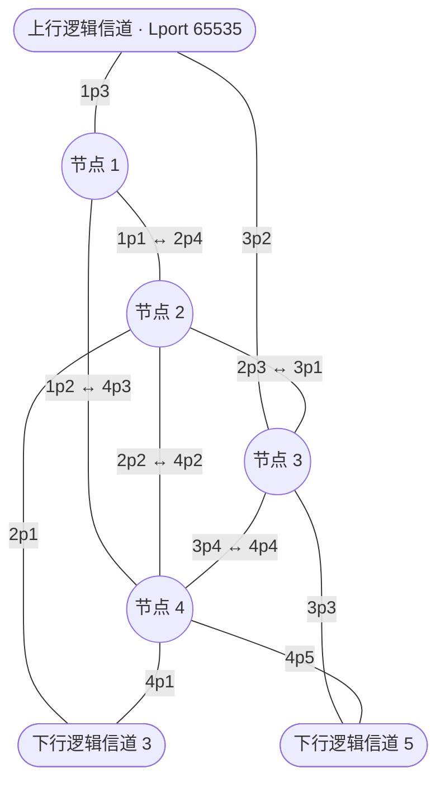

# a/b 层次交换网络实验

本项目实现课件《第3-4次-层次网络》第 26～36 页的四交换节点拓扑：一个上行逻辑信道、两个下行逻辑信道，每个外部信道都接入两个交换节点。交换程序使用完整 IPv6 地址，按 a/b 字段查全域外部端口表（EPT），选定出口后封装 EPID，在域内按 SID 查内部转发表（IFT）。

C 程序负责交换、源地址校验和 CRC-16 校验；UDP、有线/Wi-Fi 网卡及 BR/EDR L2CAP 负责承载。Open vSwitch 验收把程序放入独立网络命名空间，核对业务包确实经过 OVS。

以下操作在 **Ubuntu 24.04 的 Bash 终端、仓库根目录**执行。Windows 可使用 Ubuntu 虚拟机。当前虚拟机验收记录见[拓扑与 a/b 验收](docs/topology-test-report.md)；真实有线、Wi-Fi 和蓝牙设备测试由使用者继续完成。

## 拓扑与端口



`1p3` 表示节点 1 的逻辑端口 3。下面的 UDP 端口是传输端点，与逻辑端口编号不同。

| 域内连线 | 两端 UDP 端口 |
|---|---|
| 1p1 ↔ 2p4 | 1101 ↔ 3004 |
| 1p2 ↔ 4p3 | 1102 ↔ 4003 |
| 2p3 ↔ 3p1 | 3003 ↔ 2001 |
| 2p2 ↔ 4p2 | 3002 ↔ 4002 |
| 3p4 ↔ 4p4 | 2004 ↔ 4004 |

| 外部信道 | 两个接入端口（UDP） | 共享信道进程（UDP） |
|---|---|---|
| 上行 | 1p3（1103）、3p2（2102） | chUp（9101） |
| 下行 3 | 2p1（3101）、4p1（4101） | ch3（9102） |
| 下行 5 | 3p3（2103）、4p5（4105） | ch5（9103） |

每个 `channel.py` 进程模拟图中的一个外部网络，共享该网络的主机学习表。它把一个入域包交给一个接入节点，允许从另一节点回程；不复制泛洪、不修改 TTL。四个交换节点各持有完整 EPT 和自己的 IFT，信道进程不替它们计算域内路线。

## a/b 与示例地址

本实现约定 **最高位为 bit 0**。`32/8` 取 IPv6 地址的第 32～39 位，即第 5 个字节；地址前 32 位表示当前域的前缀 `2001:db8::/32`。目的在域内时，该字段决定下行逻辑信道；目的不在域内时走上行。上行 EPT 使用课件中的保留值 `65535`。

| 会话 | IPv6 逻辑地址 | 主机 UDP | 所属网络 |
|---|---|---:|---|
| hA1 | `2001:db9::1` | 9001 | 上行 |
| hA2 | `2001:db9::2` | 9005 | 上行的第二个站点 |
| hB1 | `2001:db8:300::1` | 9002 | 字段值 3 |
| hC1 | `2001:db8:500::1` | 9003 | 字段值 5 |
| n1～n4 | `2001:db8:ff00::1`～`::4` | 见端口表 | 节点诊断地址 |

IPv6 逻辑报文封装在实验 UDP/L2CAP 链路中，无需把这些 IPv6 地址配置到 Linux 网卡，也无需开启系统 IPv6 转发。网卡上的 IPv4 地址只用于承载。

## 编译与单机运行

```bash
sudo apt-get update
sudo apt-get install -y build-essential python3 git tmux
git clone -b integration/prs-and-readme https://github.com/github-shen/cs-project-20261030.git
cd cs-project-20261030
make
bash scripts/run_tmux.sh
```

已有仓库时直接进入相应分支后执行 `make`。默认读取 `config-hier/`，无需 root。启动成功应有 11 个就绪会话：`n1`～`n4`、`chUp/ch3/ch5`、`hA1/hA2/hB1/hC1`。启动器拒绝覆盖已有同名会话；部分程序启动失败时会关闭本次已启动的会话。

发送上行终端 → 下行 5 的消息：

```bash
tmux -L cnet send-keys -t hA1 'send 2001:db8:500::1 hello' Enter
sleep 1
tmux -L cnet capture-pane -p -t hC1 -S -30
```

应看到 `[RECV] 来自2001:db9::1: "hello"`。再验证内部交付、校验和表项：

```bash
tmux -L cnet send-keys -t n1 'send 2001:db8:ff00::4 node-test' Enter
tmux -L cnet send-keys -t hA1 'sendbad 2001:db8:500::1 bad-crc' Enter
tmux -L cnet send-keys -t n1 'table' Enter
tmux -L cnet send-keys -t n1 'stats' Enter
sleep 1
tmux -L cnet capture-pane -p -t n4 -S -30
tmux -L cnet capture-pane -p -t chUp -S -30
tmux -L cnet capture-pane -p -t n1 -S -80
```

节点 4 应交付 `node-test`；`chUp` 应报告坏 CRC，hC1 不应收到 `bad-crc`。每个节点入口也独立检查 CRC，自动验收包含绕过信道进程直接注入的错误帧。

进入交互终端用 `tmux -L cnet attach -t n1`，按 Ctrl+B 再按 D 返回。停止整组演示：

```bash
bash scripts/stop_all.sh
```

此命令只关闭项目的 `cnet` tmux 服务器。完成手工演示后再运行下节测试，避免默认端口被占用。

| 命令 | 适用进程 | 用途 |
|---|---|---|
| `send <IPv6> <文本>` | 节点 / 主机 | 正常发送，文本最多 199 字节 |
| `sendbad <IPv6> <文本>` | 节点 / 主机 | 发送错误 CRC |
| `table` / `stats` | 节点 / 信道 | 查看表和统计 |
| `via 1` 或 `via 3` | chUp | 切换该外部网络的入域节点 |
| `via 2` 或 `via 4` | ch3 | 切换下行 3 的入域节点 |
| `via 3` 或 `via 4` | ch5 | 切换下行 5 的入域节点 |
| `link <PID> up\|down` | a/b 节点 | 修改本地端口状态 |
| `ept <SID> <PID> up\|down` | a/b 节点 | 修改本节点持有的出口状态 |
| `quit` | 节点 / 主机 / 信道 | 退出 |

EPT 状态目前是静态配置或人工更新。模拟全域出口停用时，需向四个节点都发送对应的 `ept` 命令。`via` 只选择入域节点，出域 EPID 由交换节点按 EPT 独立选择。

## 自动验收

每次给测试指定一个新的输出目录。退出码 0 表示检查及资源清理均通过。

```bash
# 四节点、三信道及 a/b、源校验、加权分流、备用路由
python3 -m unittest discover -s tests -p 'test_topology.py' -v
python3 -m unittest discover -s tests -p 'test_hier_config.py' -v
python3 tests/test_hier_integration.py --output logs/hier-run1

# OVS 的七个独立命名空间与业务包计数
sudo apt-get install -y openvswitch-switch iproute2
sudo systemctl start openvswitch-switch
sudo python3 scripts/ovs_acceptance.py --hierarchical --output logs/ovs-run1

# 两条隔离 veth 路径上的绑定、断链、备用路径和恢复
sudo python3 tests/test_nic_regressions.py --hierarchical --output logs/nic-run1
```

a/b 集成验收有 8 组检查：包含内部 12 个方向、6 个外部接入点双向收发、8 种入口组合共 48 次跨信道交付、跨节点回程、非法包拒绝、64 条稳定地址流、备用路由和非字节对齐的 `29/11`。OVS 验收有 32 项；结果在 `result.json`，其他集成脚本在 `summary.json`。

真实 L2CAP 的虚拟控制器验收见[蓝牙操作说明](docs/bluetooth.md)。自动测试的 veth、虚拟 HCI、VMware 网卡不能代替真实有线/Wi-Fi/蓝牙设备测试。

## 配置、部署与边界

- [协议与表项](docs/hierarchical-protocol.md)：EPT/IFT、EPID、a/b 范围、帧布局、分流及状态处理。
- [部署与抓包](docs/deployment.md)：双机 LAN、双接口、OVS 手工演示及真实介质验收步骤。
- [蓝牙信道](docs/bluetooth.md)：在保持双接入拓扑的情况下替换一条链路。
- [本次验收记录](docs/topology-test-report.md)：运行环境、结果文件、已验证范围。

`config-hier/` 是课程模式的默认配置。`config/`、`config-ovs/`、`config-lan/`、`config-nic-template/`、`config-app/` 保留旧 16 位格式供兼容回归和转换；它们的连线和端口也已修正。用 `scripts/hier_config.py` 可从这些配置生成 a/b 版本，示例见部署文档。旧的 `demo.sh/demo_nic.sh/link_test.sh/app_demo.sh` 使用 16 位地址和旧会话名，不能直接对默认 a/b 会话运行。

当前 IFT/EPT 为静态表。能处理显式停用和本机 `sendto` 报错后的内部备用路径，但不检测远端静默黑洞，也不会把蓝牙断线自动同步到 EPT。业务无 ACK/重传，CRC 和源前缀检查不提供终端身份认证。
