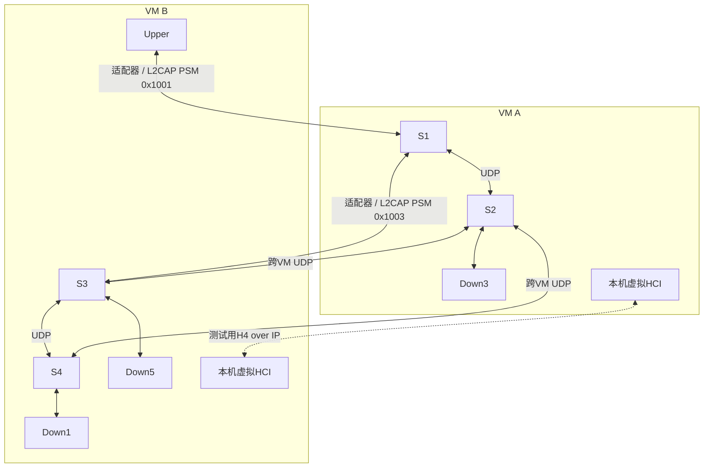

# 蓝牙信道实验报告

## 验证范围与环境

2026年10月31日（UTC+8）在本机 VMware Workstation 中完成单VM及双VM测试。被测代码以仓库 `9a0d6b6` 为基础增加原生L2CAP适配器，四节点既有交换逻辑保持原样。最终结果均为实际进程输出、终端接收记录和HCI抓包，未使用预期字符串代替业务接收。

| 项目 | VM A | VM B |
|---|---|---|
| 来源 | 复用现有Ubuntu虚拟机，在独立子目录部署 | 使用本机Ubuntu cloud image新建专用测试VM |
| Ubuntu | 24.04.5 LTS | 24.04.5 LTS |
| Linux | 6.8.0-147-generic | 6.8.0-142-generic |
| CPU架构 | x86_64 | x86_64 |
| Python | 3.12.3 | 3.12.3 |
| BlueZ / 开发库 / test-tools | 5.72-0ubuntu5.8 | 5.72-0ubuntu5.8 |
| 蓝牙硬件 | 无 | 无 |
| 虚拟控制器 | BlueZ btvirt + hci_vhci | hci_vhci，经测试H4/IP连接A的模拟控制器 |

两端均实际执行 `make bluetooth`。新增C适配器另用 `-Wall -Wextra -Werror -O2` 编译通过；配置拒绝测试3组通过，包括默认加密级别、显式low许可、无效JSON/地址/PSM/端口。Python采用3.8兼容语法；Ubuntu20.04/BlueZ5.53及真实Python3.8运行环境未复测。

单VM使用3个虚拟HCI、4个交换节点及4个终端。双VM布局如下：

## 测试方法与结果

单VM命令：`sudo python3 tests/test_bluetooth.py --output logs/virtual-final`。

双VM命令：在已配置SSH与sudo的协调机运行 `python3 tests/test_two_vm.py /path/to/two-vm.local.json --output logs/two-vm-final --run-name two-vm-final`。各VM的源码独立编译，测试worker只控制本次启动的进程。完整部署步骤见 [蓝牙信道说明](bluetooth.md)。

| 验收项 | 方法 | 实际结果 | 状态 |
|---|---|---|---|
| 外部蓝牙信道 | Upper与S1之间使用PSM0x1001 | 两端实际L2CAP连接，收发计数增长 | PASS |
| 内部蓝牙链路 | S1与S3之间使用PSM0x1003 | 接收帧继续经过内部表和外部表转发 | PASS |
| 四终端双向通信 | Upper/Down3/Down5/Down1任意有序对发送唯一标记 | 单VM12/12、双VM12/12到达目的终端 | PASS |
| 真实多流分流 | 0x0A01～0x0A40各发一帧到0x0C01 | 两种环境均64/64接收，S1两个端口各32帧 | PASS |
| 非授权蓝牙对端 | 第三个虚拟控制器连接固定对端监听器 | 服务端拒绝，denied=1 | PASS |
| 非授权本地应用 | 从非配置UDP端口发送 | 适配器拒绝并记录denied | PASS |
| 源地址校验 | 从0x0A外部信道注入源0x0B02 | S1源地址错误=1，拒绝该帧 | PASS |
| CRC校验 | Upper的sendbad经蓝牙发送 | S1 CRC错误=1，目的终端未收到标记 | PASS |
| 长度检查 | 短头、短payload、额外尾随字节、超大数据报 | 4种均拒绝，invalid=4 | PASS |
| 断线恢复 | 停止外部客户端，离线时反向发一帧，再重启 | 离线帧丢弃；重连后双向成功，无旧帧重放 | PASS |
| 清理与隔离 | 对照前后默认路由/Namespace/OVS Bridge、HCI及服务状态 | 两种环境全部保持/恢复；测试进程退出 | PASS |
| 重复执行 | 修复模拟环境干扰后再次完整运行 | virtual-final及two-vm-final均PASS | PASS |
| 原生蓝牙加密和配对 | 默认medium/high真实设备验证 | 无硬件；虚拟实验使用显式low | NOT VERIFIED |
| 真实有线、Wi-Fi、蓝牙射频 | 设备与实际对端接入 | 本次只有虚拟网卡/虚拟HCI | NOT VERIFIED |

这里的“流”沿用原程序的逻辑源/目的地址定义，不是TCP/UDP五元组；测试未把一次ping或一个UDP源端口的重复发送当作五元组负载均衡。

## 转发与计数证据

实际分布保存在 [distribution.csv](../results/bluetooth/distribution.csv)：

| 环境 | 业务接收 | S1端口1（普通UDP路径） | S1端口2（L2CAP路径） |
|---|---:|---:|---:|
| 单VM | 64 | 32 | 32 |
| 双VM | 64 | 32 | 32 |

以上只统计64帧分流实验期间的S1转发日志。下表是适配器整个生命周期的累计计数，包含连通性、安全和恢复测试，因此与64帧不能直接相加比较。

| 双VM适配器 | 蓝牙发送帧 | 蓝牙接收帧 | 发送字节 | 接收字节 | 离线丢弃 |
|---|---:|---:|---:|---:|---:|
| A外部信道服务端 | 4 | 70 | 108 | 1476 | 1 |
| A内部链路客户端 | 33 | 1 | 692 | 25 | 0 |
| B外部信道重连后的客户端 | 66 | 1 | 1380 | 33 | 0 |
| B内部链路服务端 | 1 | 33 | 25 | 692 | 0 |

A、B内部链路的收发帧数和字节数互相对应。外部服务端跨两次连接累计计数，而B重连客户端只统计第二次进程的生命周期。单VM内部链路为34帧/528字节与3帧/87字节的双向对应。

原始业务日志与结构化结果：

- [单VM结果](../results/bluetooth/single-vm.json)、[S1日志](../results/bluetooth/single-node1.log)、[本地适配器拒绝记录](../results/bluetooth/single-external-client.log)。
- [双VM结果](../results/bluetooth/two-vm.json)、[S1](../results/bluetooth/two-node1.log)、[S2](../results/bluetooth/two-node2.log)、[S3](../results/bluetooth/two-node3.log)、[S4](../results/bluetooth/two-node4.log)。
- [A端HCI证据](../results/bluetooth/a-hci.log)、[B端HCI证据](../results/bluetooth/b-hci.log)、[单VM HCI证据](../results/bluetooth/virtual-hci.log)，保留ACL、L2CAP、PSM与信道记录。

提交的日志把真实实验IP替换为 `<VM_A_IP>/<VM_B_IP>`，不包含密码、私钥、完整配对日志或大体积抓包。各VM本地 `logs/` 仍保留本次实验的完整日志和btsnoop，默认不会进入Git。

## 调试记录与结论边界

初次虚拟测试遇到桌面bluetoothd自动接管虚拟控制器、拒绝配对的问题。最终测试在确认没有已有控制器后临时隔离该服务，并核验退出后恢复。BlueZ5.72的第三对端拒绝实验还需等待其ACL释放后再建立正常会话，避免模拟器handle映射限制影响后续数据链路。相关早期失败没有记作通过。

本次验证覆盖蓝牙传输适配器与原有C交换核心的集成，支持外部信道、内部链路、地址流分流、校验拒绝和重连。静态路由不会因远端蓝牙失效自动重算，尚无丢帧重传、无线吞吐/距离结论、真实物理介质或OVS数据平面的新增验收结论。课程原始a/b定义仍需教师确认；双VM的A/B仅指机器角色。
