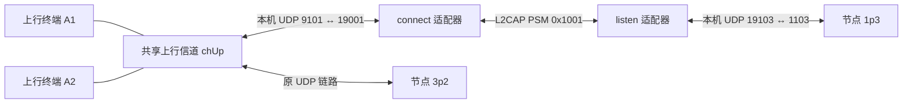

# 蓝牙信道

`bt-channel` 把一个本机 UDP 数据报作为一个 BR/EDR L2CAP SDU 发给指定对端。远端再交给本机交换端口或共享信道。它不改 TTL、CRC、IPv6 地址或 EPID；下一跳和出口仍由 C 交换节点决定。

适配器使用 `AF_BLUETOOTH / SOCK_SEQPACKET / BTPROTO_L2CAP`，同时兼容旧 16 位帧与 a/b 帧。最大内部帧为 249 字节，建立连接后检查双向 MTU。虚拟 HCI 验收已覆盖两种格式，见[本次报告](topology-test-report.md)。

## 编译和设备

```bash
sudo apt-get install -y build-essential libbluetooth-dev bluez
make bluetooth
python3 scripts/bluetooth.py probe
```

两端各需支持 BR/EDR 的控制器，只有 BLE 的设备不适用。虚拟机使用真实 USB 蓝牙时，应把控制器连接给对应客户机，核对 `lsusb`、`hciconfig -a` 和 probe 输出。

在 `bluetoothctl` 中选择实际控制器并完成双方配对、授权。示例配置默认 `medium`，使用链路加密；真实设备配对和射频性能仍需现场测试。`low` 只用于隔离虚拟控制器测试，包装器还要求显式 `--allow-insecure`。

## 替换上行信道的一条接入链路

保持题图的上行双接入结构：只把 **上行信道 ↔ 节点 1 的端口 3** 替换为蓝牙，**上行信道 ↔ 节点 3 的端口 2** 保留原承载。两端应在不同机器；共享信道与本端适配器必须在同机，因为适配器仅绑定回环地址。



先准备能互通的四节点 a/b 部署，然后复制两个适配器样例：

```bash
cp config-bt/server.example.json config-bt/server.local.json
cp config-bt/client.example.json config-bt/client.local.json
```

在各端填写真实 `local_address`、`peer_address`，互为对端；两端 PSM 同为 `0x1001`。

| 所在机器 | mode | udp_port | app_port |
|---|---|---:|---:|
| 节点 1 端 | listen | 19103 | 1103 |
| 上行信道端 | connect | 19001 | 9101 |

修改运行配置：

1. 节点 1 的外部端口改为 `port 3 ext 0xFFFF 1103 127.0.0.1 19103 type bt`。此行不绑定物理网卡，由本机适配器承担蓝牙传输。
2. 上行 `channels.json` 中，`uplinks` 的 node 1 项将 `peer` 改为 `["127.0.0.1",19001]`。`listen` 保持端口 9101；node 3 项保留其实际 IP/2102。
3. 将 chUp 和 hA1/hA2 放到客户端机器；需要分机调整时，仅改变该信道的 `role`、`listen` IP 和节点 3 上行口的 peer IP。EPT、IFT 及主机逻辑地址不变。`run_lab.py --role` 按信道的 role 安排位置。

启动两个适配器，再启动交换节点、三个信道和终端：

```bash
# 节点 1 端
sudo python3 scripts/bluetooth.py run config-bt/server.local.json
# 上行信道端
sudo python3 scripts/bluetooth.py run config-bt/client.local.json
```

两端看到 `[BT] connected` 后，向 chUp 发送 `via 1`，使用 hA1 向 hC1 发送消息，检查对端接收及适配器 `bt_tx/bt_rx`。上行回程可选节点 1 或 3；要固定走蓝牙回程，在四节点暂时执行 `ept 3 2 down`，测完执行 `ept 3 2 up`。

只写 `type bt` 不会创建蓝牙连接。主机仍向共享信道的 UDP 9101 发送，不直接连接适配器；这样同一外部网络可以有多个主机，也可从另一接入节点回程。

## 内部链路

替换节点 1—4 内部链路时，对应端口必须是 **1p2 ↔ 4p3**。为这一对适配器使用另一 PSM，例如 `0x1003`；各端 `app_port` 分别是本机交换端口 1102、4003，节点 peer 指向本机适配器 UDP 端口。两个适配器承担一条双向链路，不改变 IFT 的 SID/端口含义。

## 连接与校验

- 仅允许配置的蓝牙对端和本机 UDP 应用端口；服务端同时接受一个连接。
- 每个 SDU 必须精确匹配所属格式的长度；拒绝截断、尾随和超长数据。
- 适配器原样传递坏 CRC，由交换节点、共享信道或终端验证，便于证明端到端校验。
- 离线时丢帧，不缓存。连接完成前清空离线积压队列，避免重放旧业务。
- 客户端自动重连；服务端继续等待。`SIGUSR1` 输出统计，Ctrl+C/TERM 输出最终统计并退出。
- 本机 UDP 发送成功不表示蓝牙已经交付；蓝牙状态不会自动传播到静态 EPT/IFT。

## 专用虚拟机验收

```bash
sudo apt-get install -y bluez-test-tools "linux-modules-extra-$(uname -r)"
make bluetooth
sudo python3 tests/test_hier_bluetooth.py --output logs/bt-hier-run1
# 旧帧兼容回归
sudo python3 tests/test_bluetooth.py --output logs/bt-legacy-run1
```

测试创建三个 BlueZ 虚拟 HCI，两个用于正常链路，一个验证拒绝非配置对端；四个适配器承载外部链路和内部 1—4 链路。脚本拒绝已有控制器的环境，使用项目级锁，临时 runtime-mask Bluetooth 服务避免桌面自动配对干扰，并在退出时恢复服务与 HCI 状态。

a/b 验收包含三外部网络六个方向、内部蓝牙双向、245/249 字节最大帧、坏 CRC、错误源字段、非法长度、断线恢复与不重放。原始证据包括 `summary.json`、节点/适配器日志、`transport.btsnoop`。

`tests/test_two_vm.py` 保留旧帧的双 VM H4/IP 协调测试工具，SSH 配置见 `tests/two_vm.example.json`；它是可选兼容测试，不是本次 a/b 验收的依据。虚拟 HCI 和 H4/IP 均不能证明真实无线介质合格。
