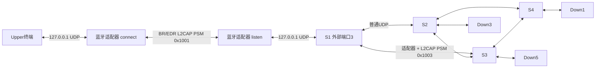

# 蓝牙信道交换

## 功能与结构

`bt-channel` 是一条双向链路的传输适配器。既有 C 交换节点仍解析 `Frame`、查外部端口表和内部转发表、检查源网络号/CRC、递减 TTL，并按照 FNV-1a 地址流哈希选择输出端口。适配器把本机 UDP 数据报作为一个 L2CAP SDU 发出；远端适配器把收到的 SDU 交给本机交换节点或终端。



适配器使用 `AF_BLUETOOTH`、`SOCK_SEQPACKET`、`BTPROTO_L2CAP`。两个不同PSM允许同一对控制器同时承载外部信道和内部链路。无线帧的下一跳仍由交换程序决定，适配器不改TTL或CRC，不算额外交换跳。

原有 `type bt` 是显示字段，不负责建立蓝牙连接。必须把相应端口的 UDP peer 指向本机 `bt-channel`，并在链路另一端运行匹配的适配器。蓝牙扩展不依赖OVS；原有OVS承载模式独立保留，本轮蓝牙实验未对OVS重新验收。

## 编译与启动

Ubuntu 20.04/24.04 使用官方软件包；本次实际运行环境为24.04，Python工具采用3.8兼容语法。

```bash
sudo apt install -y build-essential libbluetooth-dev bluez
make bluetooth
python3 scripts/bluetooth.py probe
```

`make` 仍只构建原有 `switch/host`，`make bluetooth` 增加 `bin/bt-channel`。探测命令区分虚拟控制器和硬件控制器，不扫描附近设备、不修改网络。

复制 `config-bt/server.example.json`、`client.example.json` 为 `.local.json` 后，填写两端实际蓝牙地址。样例演示 Upper ↔ S1 外部端口3：

| 端点 | mode | 本地UDP | 应用UDP | PSM |
|---|---|---:|---:|---|
| S1所在机器 | listen | 19103 | 1103 | 0x1001 |
| Upper所在机器 | connect | 19001 | 9001 | 0x1001 |

S1配置中对应一行改为 `port 3 ext 0x0A 1103 127.0.0.1 19103 type bt`。Upper启动为 `bin/host 0x0A01 9001 127.0.0.1 19001`。转发表条目保持原设计。

```bash
# S1所在机器
sudo python3 scripts/bluetooth.py run config-bt/server.local.json
# Upper所在机器
sudo python3 scripts/bluetooth.py run config-bt/client.local.json
```

本地应用和适配器UDP端口不能相同；适配器只绑定127.0.0.1，并且只接受配置应用端口的报文。服务端同时只接受一个配置对端。PSM使用动态范围且满足 `(PSM & 0x0101) == 1`，如0x1001/0x1003；两端必须一致。

## 状态与拒绝策略

| 状态/输入 | 处理 |
|---|---|
| connect启动 | 校验本地接口与权限，非阻塞连接指定对端 |
| 连接成功 | 查询L2CAP双向MTU，至少容纳完整208字节Frame；打印 `[BT] connected` |
| 连接超时 | 单次5秒，间隔1秒重试 |
| 断线 | 关闭旧连接，客户端自动重连；服务端继续等待指定对端 |
| 离线时收到业务帧 | 明确丢弃并增加 `offline`，不缓存、不在恢复后重放 |
| 连接完成时UDP仍有积压 | 在启用新连接转发前清空离线队列，来源与长度校验照常计数 |
| 非配置蓝牙地址或额外连接 | 拒绝并增加 `denied` |
| 非配置本地UDP源端口 | 拒绝并增加 `denied` |
| 长度异常/截断/尾随数据 | 拒绝并增加 `invalid` |
| 发送背压或错误 | 丢弃当前帧并增加 `errors`；永久连接错误触发重连 |

适配器要求 `实际数据报长度 == 8 + len` 且 `len < 200`。使用 `MSG_TRUNC` 检出超过接收缓冲区的数据报，避免截短后误放行。帧内容及坏CRC均原样传递；CRC-16校验和外部源网络号检查在原有 `switch/host` 接收处执行。

`kill -USR1 <适配器PID>` 输出统计；Ctrl+C/TERM会打印最终计数并关闭自己的socket。统计项包括 `bt_tx/bt_rx`、字节数、非法帧、未授权对端、离线丢弃及连接次数。

## 无硬件验证

单VM测试创建3个BlueZ虚拟HCI，运行4个交换节点、4个终端和4个适配器；第三个控制器只验证拒绝非授权对端。测试停止自己的进程，释放自己的HCI，不执行全局pkill、tmux kill-server或清空OVS。

```bash
sudo apt install -y bluez-test-tools "linux-modules-extra-$(uname -r)"
sudo python3 tests/test_bluetooth.py
```

测试拒绝已有蓝牙控制器的环境，并取得项目级文件锁。为防止桌面BlueZ自动配对策略干扰，会临时runtime-mask并停止Bluetooth服务，关闭本次虚拟控制器的SSP，在finally中恢复原服务状态。只适用于专用测试VM；强制SIGKILL无法执行finally，此时可在确认实验已停止后手动执行 `sudo systemctl unmask --runtime bluetooth.service`，按原状态恢复服务。

连接边界回归分别覆盖 `listen` 和 `connect`：暂停测试适配器，将4条合法帧、1条长度异常帧、1条非法来源帧留在UDP队列中，再完成L2CAP连接。测试要求离线帧不重放，`offline/invalid/denied` 分别为 `4/1/1`，上线后的新帧双向正常传输。客户端场景使用 `BT_DEFER_SETUP` 控制握手完成时刻。

双VM通过 `tests/test_two_vm.py` 自动协调：A运行S1/S2/Down3，B运行S3/S4/Upper/Down5/Down1。A的BlueZ模拟器提供两个虚拟控制器，其中一个通过测试专用H4/IP转接交给B的 `/dev/vhci`。每台机器使用自己的Linux蓝牙协议栈和L2CAP socket。

H4/IP转接只模拟控制器连接，不直接处理业务Frame，不参与转发表选择。它仅用于受控实验网络，显式绑定A地址且只接收B的IP，未提供身份认证或加密，不能作为生产链路。BlueZ固定的 `/tmp/bt-server-*` socket放在私有mount namespace中，不覆盖宿主已有文件。

两台VM各安装上述依赖和相同源码并执行 `make bluetooth`。协调机安装 `python3-paramiko`（Windows可使用已有Paramiko），复制 `tests/two_vm.example.json` 到仓库外填写SSH主机、用户名、密钥和已核实的known_hosts。`password_env` 仅指定环境变量名；无密码sudo的测试账户删除该键。不要把密码或私钥写进JSON。

```bash
# 协调机，仅设置确实需要sudo密码的那端；输入不回显
read -rsp 'A sudo password: ' CNET_SUDO_A; echo
export CNET_SUDO_A
python3 tests/test_two_vm.py /path/to/two-vm.local.json --output logs/two-vm-run
unset CNET_SUDO_A
```

双VM脚本通过严格校验主机密钥的SSH启动worker，所有业务数据走UDP或L2CAP信道，SSH只负责测试控制。结果保存在协调机指定目录及各VM项目的 `logs/<run-name>/`。报告中的IP作匿名化处理。

## 真实蓝牙接入

两台Ubuntu各需一个支持BR/EDR的蓝牙控制器；仅支持BLE的设备不适用。VMware中优先把USB蓝牙适配器明确连接到对应客户机。用 `lsusb`、`hciconfig -a` 和 `python3 scripts/bluetooth.py probe` 核对设备和驱动，不操作管理网卡。

由使用者在两端 `bluetoothctl` 中选择正确控制器并完成配对、连接授权；随后填写配置中的真实BD_ADDR并使用默认 `medium`。`medium` 要求链路加密，`high`要求更强认证；真实设备配对、安全级别及无线性能目前 **NOT VERIFIED**。示例配置默认medium；`low`须显式选择，Python包装器还要求 `--allow-insecure`，仅供隔离的虚拟测试。

真实验证应重复双向业务、计数、`btmon`证据和实际断开/恢复设备实验。虚拟HCI证明协议与程序路径；VMware NAT/桥接网卡、HCI over IP都不能证明真实蓝牙射频或Wi-Fi物理介质合格。

## 已知边界

- 本轮扩展保持原有C交换架构、静态表及CRC-16格式，不是Python OpenFlow控制器改造。
- 原有源校验只绑定16位地址的网络号；蓝牙增加对端地址与本机应用端口检查，不等于逐终端MAC/IP强认证。
- 一对适配器对应一个固定端点；同一端点可以发送多个逻辑地址，但多个独立应用进程应使用不同端口/PSM。
- FNV-1a按逻辑源/目的地址分流，报告中的64条地址流不是64个TCP/UDP五元组。
- 本机UDP发送成功不等于蓝牙交付成功；蓝牙断线会丢帧并重连，尚未把链路状态反馈到原有静态转发表自动改路。
- 帧头沿用主机字节序，本次双机均为x86_64；异构大小端互通未验证。
- 无业务ACK/重传、吞吐率或无线距离保证；本次没有进行无关压力测试。

实现依据：[BlueZ 5.72虚拟控制器](https://github.com/bluez/bluez/blob/5.72/emulator/vhci.c)、[BlueZ 5.72模拟器socket](https://github.com/bluez/bluez/blob/5.72/emulator/server.c)。
